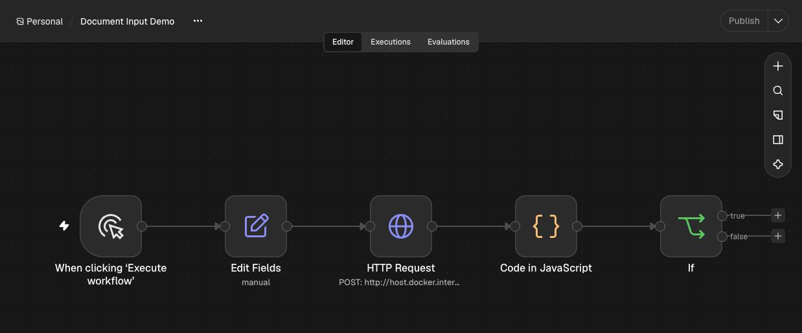
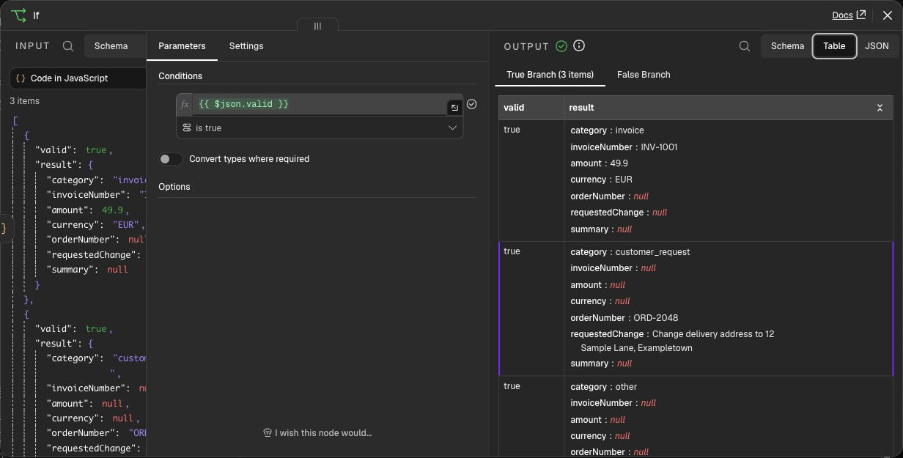
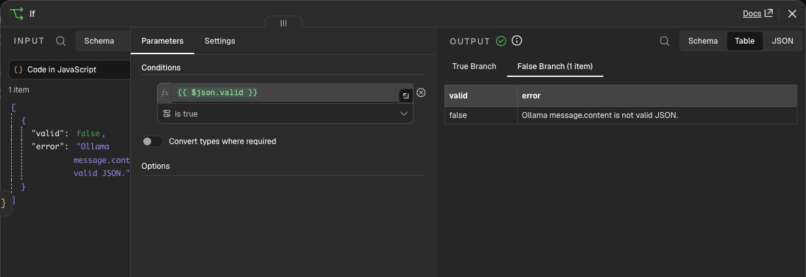

# LocalFlow AI

LocalFlow AI classifies plain-text documents as invoices, customer requests, or other documents. n8n runs the workflow, and Ollama runs the language model on the same machine. The n8n editor shows the extracted fields and the outcome of validation.

## Why I built this

I built LocalFlow AI to get hands-on experience with n8n workflow automation and local LLM integration. I wanted to connect Ollama to n8n, extract structured information, validate model responses in JavaScript, and route invalid outputs. The project also gave me a concrete way to study structural validation and semantic accuracy. A response can have the expected fields and types while assigning the wrong category or extracting the wrong value. This is a focused engineering learning project. Production document management is outside its scope.

## Workflow architecture

**Manual Trigger → Edit Fields → HTTP Request → Code in JavaScript → If**

Edit Fields provides `documentText`. HTTP Request sends it to Ollama with a JSON schema. The Code node parses `message.content` and checks the category, field names, types, and which fields must be `null`. The If node routes `{ valid: true, result }` to **True Branch** and `{ valid: false, error }` to **False Branch**.

## Screenshots







## Project structure

| Path | Purpose |
| --- | --- |
| [`docker-compose.yml`](docker-compose.yml) | Runs n8n and persists its data in a named volume |
| [`workflows/document-classifier.json`](workflows/document-classifier.json) | Workflow export for n8n |
| [`samples/`](samples/) | Three fictional input documents |
| [`docs/screenshots/`](docs/screenshots/) | Workflow and execution screenshots |

## Prerequisites and local setup

The setup was tested on an Apple silicon Mac with 8 GiB of memory, Docker Desktop, n8n `2.48.5`, and Ollama `0.40.16`. Start [Docker Desktop for Mac](https://docs.docker.com/desktop/setup/install/mac-install/) and [Ollama for macOS](https://ollama.com/download/mac) before running the commands below.

1. Download the model and confirm that Ollama is responding.

   ```sh
   ollama pull qwen2.5:1.5b
   curl --fail http://127.0.0.1:11434/api/version
   ```

   If `ollama` is unavailable on your `PATH`, replace it in the first command with `/Applications/Ollama.app/Contents/Resources/ollama`.

2. From the repository root, start n8n and wait for its health check to respond.

   ```sh
   docker compose up -d n8n
   curl --fail --retry 10 --retry-connrefused http://127.0.0.1:5678/healthz
   ```

3. Open the [local n8n editor](http://127.0.0.1:5678) and complete any first-run prompts. Create a workflow, open the canvas menu (`…`), and choose **Import from File**. Select `workflows/document-classifier.json` from your checkout. The export is named **Document Input Demo**. [n8n import documentation](https://docs.n8n.io/build/manage-workflows/export-and-import.md#from-the-editor-ui-menu)

The HTTP Request node uses `http://host.docker.internal:11434/api/chat` to reach Ollama on the Mac from inside Docker. If the request fails to connect, check that Ollama is running and that the version request in step 1 succeeds.

Stop n8n with `docker compose stop n8n`. The named volume keeps your local workflows and settings.

## Running and testing the samples

1. Open **Edit Fields** and replace the value of `documentText` with the contents of a sample file. The invoice is loaded by default.
2. Click **Execute workflow**. Open **If** and select **True Branch** in the output panel. Check the category and extracted fields in `result` against the sample below.
3. To trace the data, open **HTTP Request** for the raw Ollama response, then **Code in JavaScript** for the parsed result.

| Sample | Expected category | Expected details |
| --- | --- | --- |
| [Invoice](samples/invoice.txt) | `invoice` | `INV-1001`, `49.90 EUR` |
| [Customer request](samples/customer-request.txt) | `customer_request` | `ORD-2048`, delivery address change to `12 Sample Lane, Exampletown` |
| [Office notice](samples/other.txt) | `other` | Friday closure of the second-floor meeting rooms for maintenance |

To test **False Branch**, open **HTTP Request**, select **Edit Output**, and save the following as pinned output.

```json
[{"message":{"content":"{\"category\":"}}]
```

Click **Execute workflow**, then open **If → False Branch**. Expect one item with `valid: false` and the error `Ollama message.content is not valid JSON.` Unpin the HTTP Request output afterward to resume live requests. Connection failures appear on the HTTP Request node. The False Branch handles invalid responses that reach the validator.

## Limitations

- Testing covered the three included documents and a simulated malformed response.
- Structural validation checks the response shape. Semantic accuracy requires comparing the result with the source document.
- This setup requires Docker, n8n, and Ollama running locally.
- A fresh import of the exported workflow into a separate n8n instance has yet to be tested.
